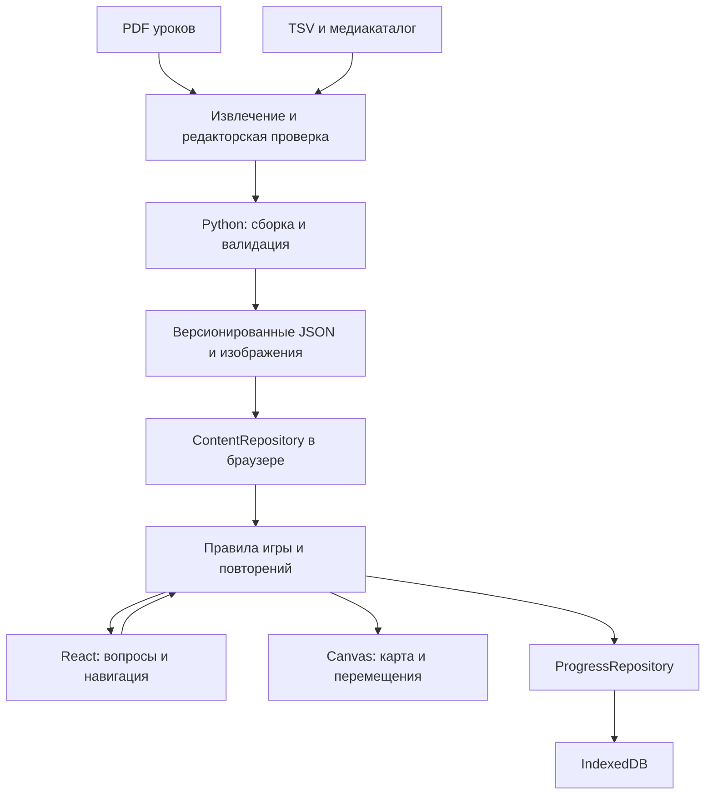
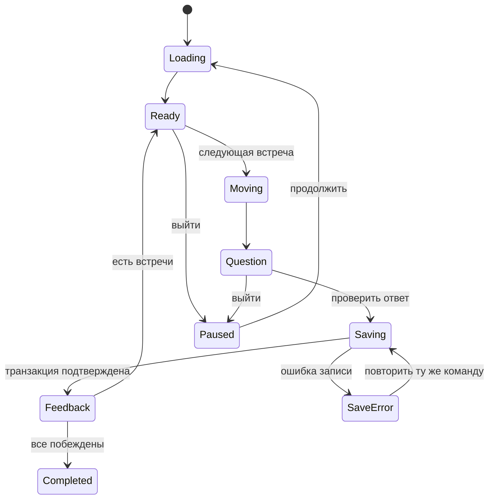

# PRD: «Гримуар французского»

Статус: проект архитектуры и геймдизайна, 15 октября 2026. Документ описывает будущую реализацию. Код игры, игровой экспорт уроков и производственные спрайты пока не созданы.

## 1. Продукт и границы первой версии

Браузерная игра для изучения французской лексики: игрок ведёт мага-ученика по аксонометрической карте, входит в урок и побеждает гоблинов правильными ответами. Каждый гоблин представляет слово или устойчивое выражение из этого урока. Знания пополняют коллекцию книг и меняют облик героя.

Основные правила:

- **Один PDF из `lessons/` — один уровень кампании.** Порядок совпадает с номером урока. Длинный урок проходится за несколько сессий, сохраняя один номер уровня.
- Есть ровно три типа ответа: выбор перевода, письменный ответ, выбор картинки. Аудирование, распознавание речи, сборка предложений и отдельные грамматические задания в первую версию не входят.
- Карта мира и маршрут внутри урока показаны в аксонометрии. Все мобы используют один дизайн гоблина.
- За каждые три впервые пройденных уровня выдаётся книга-артефакт; за каждые шесть меняется облик мага.
- Ежедневное задание содержит случайную выборку слов только из полностью пройденных уроков.
- Основной экран — мобильный, вертикальный. На десктопе отображается тот же интерфейс в узкой центральной колонке.

Принятые допущения: интерфейс и переводы на русском, изучаемый язык — французский; один локальный профиль; последовательное открытие уровней; книги и усиление героя имеют визуальный эффект и не снижают требования к ответам. Регистрация, серверная синхронизация, социальные механики, платежи и магазин не нужны для проверки этого игрового цикла.

## 2. Существующий материал и его готовность

### 2.1. Что уже есть в репозитории

| Источник | Проверенное состояние | Использование в игре |
| --- | --- | --- |
| [`lessons/`](../../lessons/) | 34 PDF, номера 01–34 | Исходная программа, 34 уровня |
| [`data/lesson_vocab.tsv`](../../data/lesson_vocab.tsv) | 341 исходная строка, только уроки 01–05 | База проверенной лексики для подготовки игрового контента |
| [`scripts/build_anki.py`](../../scripts/build_anki.py) | Python-сборка Anki; нормализация, дедупликация, источники, медиассылки | Переиспользовать правила очистки и проверки в отдельном игровом экспортере |
| [`anki/extraction_report.md`](../../anki/extraction_report.md) | 339 записей после дедупликации, 335 с изображениями; 37 изображений связаны с несколькими словами | Инвентаризация, а не подтверждение пригодности картинок для вопросов |
| [`anki/image_ambiguities.tsv`](../../anki/image_ambiguities.tsv) | Примеры неоднозначных изображений | Вход редакторской проверки визуальных вопросов |
| [`anki/pixabay_attribution.tsv`](../../anki/pixabay_attribution.tsv) | Сведения об источниках части изображений | Сохранение происхождения отобранных медиаматериалов |
| `app/` | До этой задачи — только заготовка PRD, приложения и frontend-стека нет | Новое приложение можно добавить изолированно |

Количество строк TSV по урокам: **100, 62, 73, 52, 54**. Текущая сборка Anki оставляет **100, 62, 73, 52, 52**. Два отброшенных повторения — `zéro` и `deux`. Это не готовые количества игровых мобов: окончательный состав определяет проверенный манифест урока.

Anki использует глобальную дедупликацию по французскому тексту и переводу. В игре необходимо отдельно хранить **словарную единицу** и её **вхождение в урок**. Повторение слова в другом PDF не должно удалять его из соответствующего уровня. Три существующих уровня сложности Anki **не являются уровнями кампании**.

### 2.2. Соответствие PDF и уровней

Идентификаторы кампании: `a1-01` … `a1-34`. В явном манифесте хранится точное имя файла, поэтому особенности имён не влияют на порядок:

| Уровень | Имя источника | Правило |
| --- | --- | --- |
| 1–15, 17–23, 25–31, 33–34 | `A1 NN.pdf` | Номер PDF равен номеру уровня |
| 16 | `A1 16 contrôle.pdf` | Контрольный урок остаётся одним уровнем с теми же тремя типами ответа |
| 24 | `A1 24 contrôle.pdf` | Повторяемая лексика сохраняет связь с этим уроком |
| 32 | `A1 32 .pdf` | Пробел перед расширением сохраняется в ссылке на источник (исправлено) |

В PDF 01 есть правила чтения и слова-примеры; в PDF 06 — задания на числа, в 16/24 — контрольные материалы, в 34 — ситуации в булочной. Это наблюдения по извлечённому тексту, а не полный тематический каталог. Для ряда страниц `pdftotext` возвращает мало текста: требуется визуальный просмотр и при необходимости OCR с последующей проверкой.

Отбираются слова, выражения из таблиц и рамок, а также целевая лексика упражнений с пропусками. Фонетические обозначения, имена персонажей упражнений и случайные OCR-фрагменты не превращаются в мобов. Игра тренирует выбранную лексику, а не заявляет полное воспроизведение всех упражнений PDF.

Сейчас уроки 01–05 имеют словарную основу, но требуют игровых вопросов, вариантов ответов и проверки изображений. Уроки 06–34 требуют подготовки словаря. На карте для них можно показать узлы «Готовится»; наличие PDF не означает готовый уровень. Публикуется непрерывная последовательность готовых уроков, начиная с первого.

### 2.3. Реальные примеры для прототипа

Нумерация страниц — физическая страница PDF, начиная с 1; категория соответствует TSV.

| Слово | Перевод из каталога | Источник | Применение после проверки |
| --- | --- | --- | --- |
| `fenêtre` | окно | `A1 01.pdf`, стр. 4, `box` | Выбор перевода; набор ответа; изображение окна |
| `bonjour` | здравствуйте; добрый день | `A1 02.pdf`, стр. 3, `box` | Текстовые вопросы с явными допустимыми ответами |
| `livre` | книга | `A1 03.pdf`, стр. 2, `new`; пример `le livre` | Три типа ответа после проверки картинки и дистракторов |

Фотография вечеринки, используемая для `bonjour` и `salut`, не различает эти выражения. Она может иллюстрировать объяснение, но не является готовым правильным вариантом в задании на узнавание одного из них.

## 3. Игровой цикл и экраны

### 3.1. Карта мира

Вертикально прокручиваемое поле с дорожкой и 34 пронумерованными узлами. Первый узел доступен сразу; следующий — после полного прохождения предыдущего. Состояния: «Готовится», «Закрыт», «Доступен», «В процессе», «Пройден». Готовность контента и прогресс игрока — разные признаки.

Нажатие на доступный узел открывает карточку урока: номер, редакторское название, сколько слов пройдено, кнопка «Начать» или «Продолжить». Герой перемещается по заданному участку дорожки; после движения открывается уровень. Пройденные уроки доступны для повторения. Свободное управление джойстиком, поиск пути и открытый мир не требуются.

Нижняя навигация: **Карта / Книги / Задания**. Настройки доступны из верхней панели. На карте нет боёв: гоблины находятся внутри уроков или ежедневного маршрута.

### 3.2. Маршрут внутри урока

Урок — упорядоченный маршрут с одним гоблином на каждую включённую словарную единицу. Слова идут в порядке, заданном редактором по PDF. При ошибках меняется очередь повторения, но не состав урока.

Цикл: следующая встреча → короткое перемещение → вопрос → ответ → объяснение → перемещение дальше. Кнопка «Дальше» и нажатие на следующего доступного гоблина вызывают одно действие. На экране виден ближайший участок, а не все 100 мобов первого урока.

Правильный ответ запускает магический эффект, гоблин исчезает, встреча отмечается побеждённой. Общий дизайн: зелёная округлая голова, коричневая туника с поясом, маленькая деревянная дубинка; различается только связанный вопрос. Допустимы состояния ожидания, реакции и исчезновения, но не новые виды врагов или боссы. Бой условный, без изображения травм.

При ошибке показываются правильный ответ, французское слово, перевод и проверенный пример. Гоблин остаётся непобеждённым и возвращается в очередь после двух других вопросов, если они есть; в конце очереди повторяется после закрытия объяснения. Ошибка не отнимает побеждённых мобов и не создаёт ограничение жизней. Урок завершён, когда **каждая обязательная встреча имеет хотя бы один правильный ответ**.

«Не знаю» считается ошибкой с объяснением. Подсказка с раскрытием ответа не побеждает моба: требуется повторный вопрос. Повтор после объяснения помогает закончить маршрут, но не выдаётся за независимое доказательство запоминания.

### 3.3. Короткие сессии и продолжение

Целевой объём сессии — около 10 ответов или 5–7 минут, без таймера, прерывающего игрока. После 10 ответов предлагается остановиться или продолжить. Сохранение происходит после каждого ответа.

Например, урок 01 содержит около 100 кандидатов в словарь. После победы над 10 словами игрок вернётся к тому же уровню 1 со статусом «В процессе: 10/100», а не к уровню 1.2. Количество ответов с ошибками может превышать количество мобов.

Одновременно сохраняются незавершённая кампания и одно ежедневное прохождение. При переключении текущий маршрут ставится на паузу. Возврат не меняет вопрос, варианты или уже полученный результат.

После сессии показываются число побед, ошибки и слова для повторения. После полного урока дополнительно открывается следующий узел и показывается пороговая награда. Длительность и процент верных ответов — информационные показатели, не условия перехода.

Экран «Книги» содержит мага в текущем облике, полученные тома, ближайшие пороги наград и словарь пройденных уроков. Просмотр слова с переводом не считается ответом и не меняет усвоение.

## 4. Вопросы и правила проверки

| Тип | Что видит игрок | Ответ | Условие доступности |
| --- | --- | --- | --- |
| `translation_choice` | Французское слово/выражение, при необходимости контекст; четыре русских варианта | Один вариант | Один однозначно правильный и три проверенных неверных варианта |
| `typed_translation` | Слово/выражение и указание языка ответа | Свой текст | Редактор задал принимаемые варианты и направление |
| `image_choice` | Французское слово/выражение; четыре изображения 2×2 | Одна картинка | Все изображения просмотрены; смысл допускает единственный ответ |

Для набора текста базовое направление — французский → русский. Русский → французский разрешается для отдельно проверенного вопроса с достаточным контекстом и перечнем ответов. Это та же механика письменного ответа. Пользователь всегда видит «Напиши по-русски» или «Напиши по-французски».

Режим выбирается из разрешённых для слова. В первом знакомстве предпочтителен выбор перевода; при повторениях доступны остальные подготовленные режимы. Пользователь может выбрать письменный ответ. Отсутствие картинки не блокирует слово. Перезапуск страницы не перебрасывает режим.

### 4.1. Варианты и изображения

- Дистракторы задаются редактором или выбираются из проверенного пула с совместимым контекстом. Генерация вариантов моделью во время игры не нужна.
- Два корректных синонима не конкурируют как правильный и неверный ответ: для `bonjour` это, например, «здравствуйте» и «добрый день».
- Проверяемый ответ не берётся из будущего урока. В кампании дистракторы ограничены текущим и пройденными уроками; в daily — только пройденными уроками из снимка задания. Если трёх хороших нет, используется подготовленный письменный вопрос.
- Картинки должны различаться по смыслу: одинаковый файл, кадрирование той же сцены или две подходящие сцены не могут быть разными ответами. Разные хеши не доказывают однозначность.
- `image_choice` разрешается только после проверки всех четырёх вариантов вместе. Абстрактные слова без однозначного визуального сюжета остаются в текстовых режимах.
- Картинки загружаются до открытия вопроса. При сбое доступны повтор загрузки или подготовленный текстовый вопрос того же моба; замена сохраняется и не считается ошибкой игрока.

Варианты, порядок и правильный `optionId` фиксируются при создании вопроса. Проверка идёт по ID, а не по тексту или позиции кнопки. Повторная встреча после ошибки получает новый `questionId`, сохраняя связь с тем же мобом; отвеченный вопрос не открывается для новой попытки под прежним ID.

### 4.2. Набор текста

Проверка детерминирована: Unicode NFC, регистр, пробелы по краям и их повторения, типографский/прямой апостроф приводятся к одному виду. Для русского ответа `ё` и `е` можно считать эквивалентными. Остальные преобразования — только явно заданные правила вопроса.

Французские акценты, артикли, дефисы, число и род не отбрасываются автоматически. `ou`/`où` и `a`/`à` могут иметь разные значения. Ответ `fenetre` на ожидаемое `fenêtre` получает мягкое пояснение «Проверь знак над буквой» и возможность исправления, но ещё не побеждает моба. Под французским полем доступны `à â ç é è ê ë î ï ô ù û ü œ`; системная клавиатура остаётся основной.

Синонимы, допустимые артикли и словоформы записываются отдельными `acceptedAnswers`. Строки TSV с `;` или `/` нельзя автоматически считать взаимозаменяемыми ответами: формы рода и разные значения требуют редакторского решения. Расстояние Левенштейна допустимо для подсказки, не для зачёта: `poisson` и `poison` — разные слова.

Пустая строка не создаёт попытку. Двойное нажатие «Проверить» не создаёт два ответа. После проверки поле блокируется до сохранения. Правильный вариант после ошибки не повышает показатель ответа с первой попытки.

## 5. Развитие героя и усвоение слов

### 5.1. Маг и награды

Герой — маг-исследователь с книгой и посохом. Стартовая книга, если она показана в облике, — обычный учебник и не входит в коллекцию артефактов: при `C = 0` наградных книг нет. Полученная книга появляется в коллекции; часть томов сопровождает его в сцене. Одновременно вокруг героя показываются не более трёх книг, полный набор доступен в коллекции.

Пусть `C` — число уникальных полностью пройденных уровней кампании:

```text
число книг = floor(C / 3)
индекс облика = floor(C / 6)     // 0 — начальный облик
```

| Впервые пройдено уровней | Новая книга | Облик |
| --- | --- | --- |
| 0 | — | 0: ученик, простой плащ и книга |
| 3 | Том I | 0 |
| 6 | Том II | 1: уверенный ученик, более выразительный посох |
| 9 | Том III | 1 |
| 12 | Том IV | 2: хранитель книг |
| 15 | Том V | 2 |
| 18 | Том VI | 3: маг-исследователь |
| 21 | Том VII | 3 |
| 24 | Том VIII | 4: мастер библиотеки |
| 27 | Том IX | 4 |
| 30 | Том X | 5: архимаг знаний |
| 33 | Том XI | 5 |
| 34 | — | 5; завершение текущей кампании |

Для 34 уроков: **11 книг и 6 обликов, включая стартовый**. Ноль означает число пройденных уроков или стартовый индекс облика, а не отдельный уровень 0. Названия и детали костюмов рабочие; пороги фиксированы. Новые формы сохраняют силуэт мага, добавляя детали одежды, посоха и магии.

Порог 6 одновременно даёт книгу и облик. Replay, daily и повторный показ итогов не увеличивают `C`. Отдельная шкала опыта для этих наград не нужна. Награды имеют стабильные ключи `book:3`, `form:6` и т. п.; анимация отделена от факта получения. Если приложение закрыто во время анимации, награда уже сохранена.

### 5.2. Прогресс маршрута и знание слова

| Слой | Что хранит | На что влияет |
| --- | --- | --- |
| Прогресс урока | Побеждённые встречи, первое завершение | Карта, следующий урок, книги и облики |
| Усвоение | Попытки, первый ответ, ошибки и срок повторения по слову/режиму/направлению | Ежедневные повторения и статистика |

Прохождение не означает, что все слова навсегда выучены. Ошибка в daily не закрывает уровень и не отнимает книгу. Слово в одном значении, встречающееся в нескольких уроках, имеет общее усвоение, но отдельные встречи.

Начальная политика повторений: после успешной независимой проверки интервалы **1 → 3 → 7 → 14 дней**, затем 14 дней; после ошибки срок возвращается к следующему учебному дню. Это стартовые настройки продукта, а не доказанная персональная модель памяти. Состояния — «новое», «учится», «повторяется».

Независимая проверка — первый ответ на это слово в данном режиме и направлении за учебную дату, без раскрытия ответа. Следующая ступень доступна только когда наступил срок повторения. Перебор вариантов, исправление после объяснения и повтор прохождения в тот же день не продвигают ступень. Все попытки могут входить в статистику, но показатели первой попытки считаются отдельно.

## 6. Ежедневные задания

### 6.1. Создание задания

1. При создании профиля сохранить случайный `profileId` и учебную временную зону IANA, изначально выбранную по браузеру. Дата задания — календарная дата в этой зоне, не UTC и не таймер на 24 часа.
2. При первом открытии задания за дату собрать слова из **полностью пройденных** уроков. Частично пройденный урок не входит. Одинаковое слово в одном значении включается один раз независимо от числа источников.
3. При пустом пуле показать «Пройди первый урок, чтобы открыть ежедневное задание» и не создавать пустое завершённое задание. После завершения первого урока в тот же день задание можно создать.
4. Выбрать `N = min(10, размер пула)` разных слов. До семи мест — случайная выборка среди слов со сроком повторения; оставшиеся — случайная выборка из остального пула. Если одной группы мало, заполнить из другой. Не добивать маленький пул дублями.
5. Сохранить снимок: дату, зону, версии контента и алгоритма, доступные источники, выбранные слова, режимы, вопросы и порядок вариантов. Seed генератора — `profileId + date + contentVersion + algorithmVersion`; сохранённый снимок окончателен.

У разных игроков набор может отличаться. Усвоение задаёт приоритет, но не разрешает слова из непройденных уроков. Контекст и режим берутся из допустимого пройденного источника.

### 6.2. Прохождение и границы даты

Daily — короткий маршрут с теми же гоблинами и правилами ответа. После победы над всеми `N` мобами сохраняется выполнение за исходную дату. Награда — отметка дня и результат повторения; книг, обликов и открытия уровней нет.

| Ситуация | Поведение |
| --- | --- |
| Reload или закрытие вкладки | Восстановить тот же снимок, вопрос и зачтённые ответы |
| Новый урок пройден после создания задания | Сегодняшний набор не менять; новые слова участвуют со следующей даты |
| Полночь во время прохождения | Разрешить закончить задание с его исходной датой; затем предложить сегодняшнее |
| Вчерашнее задание не окончено | Можно продолжить либо архивировать незавершённым и начать сегодняшнее; усвоение от ответов сохранить |
| Повтор за ту же дату | Тренировка с прежним набором, без второй отметки/награды |
| Изменение зоны | Активное задание сохраняет дату и зону; настройка применяется после выхода, для даты без существующего задания |
| Возврат системной даты назад | Существующую запись даты переиспользовать, без повторной награды |
| Обновление каталога | Незавершённый набор использует закреплённую версию; новый — новую опубликованную |

Смена зоны не перезаписывает задания. Старое задание после полуночи обновляет усвоение на фактическую учебную дату ответа, но отметку получает за дату создания. Нельзя создать две активные копии с одним ключом даты. Серии посещений и наказание за пропуск не вводятся.

Устройство остаётся источником времени: без сервера нельзя гарантировать защиту от смены часов или редактирования сохранения. Для одиночной игры без экономики и рейтинга это допустимое ограничение.

## 7. Визуальное направление и мобильный интерфейс

### 7.1. Арт и референсы

Пиксельарт с читаемыми силуэтами, ромбическими тайлами 2:1 и постоянной аксонометрической камерой. Рабочая сетка — тайл 32×16 логических пикселей; масштаб уточняется на телефоне. Мир, персонажи, книги и рамки используют согласованные цвета и плотность пикселей.

Учебные вопросы набираются обычным читаемым экранным шрифтом с французскими знаками и кириллицей. Пиксельный шрифт допустим для коротких декоративных заголовков. Текст кнопок и вопросов не запекается в изображения.

Существующие фотографии можно использовать в прототипе после проверки. Позже их можно заменить пиксельными иллюстрациями; замена заново проходит проверку узнаваемости. Стиль не важнее однозначности значения.

| Референс | Назначение |
| --- | --- |
| [01-world-map.png](../refs/01-world-map.png) | Мобильная карта, дорожка, номера и состояния уровней |
| [02-lesson-encounter.png](../refs/02-lesson-encounter.png) | Маршрут урока, маг, одинаковые гоблины, область вопроса |
| [03-mage-progression.png](../refs/03-mage-progression.png) | Стартовый и усиленные облики, книги-артефакты |
| [04-question-modes-v2.png](../refs/04-question-modes-v2.png) | Три вида ответа на мобильном экране; согласованный дизайн гоблина |
| [README.md](../refs/README.md), [PROMPTS.md](../refs/PROMPTS.md) | Описание изображений, способ генерации и промпты |

Это концепты композиции и стилистики, не готовые атласы спрайтов и не точные макеты всех состояний. При расхождении чисел, текстов или наград на изображении с PRD используется PRD.

### 7.2. Экран и управление

- Рабочая ширина 320–480 CSS px; на широком экране `max-width: 480px` и центрирование. Отдельной desktop-компоновки нет.
- Сцена сверху, задание и ответ снизу. При открытии клавиатуры сцена уменьшается, поле и проверка остаются видимыми. Длинные выражения переносятся.
- Учитывать safe area и динамическую высоту браузера. Поворот устройства сохраняет состояние; остаётся та же колонка с вертикальной прокруткой.
- Основные зоны нажатия — минимум 44×44 CSS px с промежутками. Это цель продукта; WCAG 2.2 AA задаёт отдельное условие 24 CSS px с исключениями. [W3C: Target Size](https://www.w3.org/WAI/WCAG22/Understanding/target-size-minimum.html).
- Один тап — одно действие. Во время движения или сохранения повторный переход блокируется.
- Перемещение ориентировочно 250–450 мс. Для `prefers-reduced-motion` движение и магия заменяются краткой сменой состояния. [MDN: prefers-reduced-motion](https://developer.mozilla.org/en-US/docs/Web/CSS/Reference/At-rules/@media/prefers-reduced-motion).

### 7.3. Доступность

Вопросы, варианты, прогресс и навигация — HTML-элементы. Canvas не является единственным способом открыть уровень или встречу: есть кнопка следующего шага и список уровней с теми же действиями. Нужны видимый фокус, клавиатура и результат через `aria-live` без повторного озвучивания всей сцены.

Правильность обозначается текстом и значком, а не одним цветом. Контраст обычного текста — не ниже 4,5:1, крупного — 3:1. [W3C: Contrast Minimum](https://www.w3.org/WAI/WCAG22/Understanding/contrast-minimum.html).

Картинки имеют осмысленные описания. Поскольку описание может раскрыть ответ, нужен явный переключатель на эквивалентный текстовый вопрос того же слова: прогресс сохраняется, статистика учитывает фактически выполненный режим. Увеличение текста до 200% не скрывает ответ и кнопки.

## 8. Архитектура MVP

### 8.1. Решение

**Одно статическое клиентское приложение: Vite + React + TypeScript, Canvas 2D для сцен, HTML/CSS для интерфейса, IndexedDB для состояния.** Контент подготавливается Python-инструментарием и отдельным игровым экспортером. Это предложение для будущей реализации: существующего frontend-стека в репозитории нет.

Vite формирует статические ресурсы и предоставляет шаблон React/TypeScript. React описывает такой подход и его ограничения: маршрутизацию и загрузку данных нужно организовать самостоятельно. Здесь достаточно нескольких локальных экранов и статического каталога, требований к SSR нет. Выбор — проектное решение. [Vite Guide](https://vite.dev/guide/), [React: Build an App from Scratch](https://react.dev/learn/build-a-react-app-from-scratch).

Canvas 2D достаточен для фиксированной камеры, дорожки и нескольких спрайтов. Отдельный движок рассматривается при появлении свободного исследования, сложных сцен или измеренной проблемы рендера. Backend, SQL-база, очередь, CMS, WebSocket и LLM во время игры не требуются.



### 8.2. Границы модулей и владение

| Модуль | Ответственность | Что ему не принадлежит |
| --- | --- | --- |
| `content` | Манифест, пакеты, формат, доступность урока | Награды и прогресс |
| `domain` | Ответы, очередь, завершение, награды, усвоение, daily | DOM, анимации, прямой доступ к IndexedDB |
| `application` | Команды, сохранение, ошибки, восстановление | Рисование тайлов |
| `persistence` | Транзакции, версии схемы, импорт/экспорт | Правильность ответа |
| `rendering` | Проекция, камера, спрайты, анимации | Победа над мобом и начисление книги |
| `ui` | Экраны, ввод, фокус, доступность | Собственная копия игровых правил |
| Python-экспортер | Данные, стабильные ID, источники и медиа | Публикация непроверенных слов |

Контент-редактор отвечает за материал и смысл вопросов; frontend-разработчик — за приложение и сохранение; художник — за спрайты; QA — за мобильный ввод, восстановление и награды. Один человек может совмещать роли.

Предлагаемая будущая структура, а не уже созданные файлы:

```text
app/
  docs/PRD.md
  refs/                         # концепты этой задачи
  content/                      # ID, связи с PDF, игровые аннотации
  public/content/<version>/     # manifest и пакеты уроков
  public/assets/                # оптимизированные картинки и атласы
  src/{content,domain,application,persistence,rendering,ui}/
scripts/build_game_content.py    # отдельный экспорт; Anki-сборка сохраняется
```

Для начала достаточно состояния React и чистых функций домена; отдельный state-manager не обязателен. Кадры canvas работают вне React render-цикла. Hash-маршруты экранов позволяют обойтись без серверных правил маршрутизации.

## 9. Контентные и локальные контракты

### 9.1. Подготовка контента

1. Реестр 34 источников: номер, точное имя PDF, хеш и статус. Названия уровней утверждает редактор.
2. Для 01–05 читать TSV, для 06–34 извлечь кандидатов. OCR даёт черновик; слова, перевод, страницу и контекст проверяет человек.
3. Присвоить стабильные `lexemeId` и `entryId`. Словарная единица обозначает одно значение; омонимы разделены. Исправление опечатки/изображения не меняет ID. Реестр ID не строится только из текста перевода.
4. Сохранить все связи с уроками и страницами; объединять повторы внутри урока после проверки. Глобальная дедупликация не уменьшает словарь другого урока.
5. Подготовить допустимые ответы, направления, дистракторы и медиа. Игровые аннотации хранить отдельно от полей TSV, сохраняя контракт Anki.
6. Валидировать и собрать манифест и отдельный пакет на урок. Копировать используемые оптимизированные медиа с происхождением. PDF, ключи и Anki backup не включать в публичную сборку.
7. Публиковать только проверенные пакеты. Пустой/непроверенный урок остаётся `draft`, не превращаясь в автоматически проходимый.

Блокирующие проверки: пропущенный номер или дублирующийся ID, неизвестный PDF, страница вне файла, пустой опубликованный урок, отсутствие правильного ответа, несколько правильных вариантов, отсутствующее медиа, неверная ссылка на слово, image-режим без отметки проверки. Семантическую однозначность отдельно подтверждает редактор: схема JSON этого не доказывает.

Контент имеет `schemaVersion` и `contentVersion`; активный запуск закрепляет версию. Исправление текста сохраняет прогресс. Изменение смысла требует нового `lexemeId` либо миграции. Уже завершённый уровень не отнимается после добавления слов; новый состав доступен при повторном прохождении, запись первого завершения сохраняет исходную версию.

### 9.2. Основные сущности

| Сущность | Ключевые поля и инварианты |
| --- | --- |
| `ContentManifest` | Версии схемы/контента, `lessons[]`; уникальные номера, один PDF на урок |
| `Lesson` | `lessonId`, `order`, `sourceFile`, `sourceHash`, `status`, `title`, `entryIds[]`; список непуст для `published` |
| `Lexeme` | `lexemeId`, `french`, `translationRu`, `pronunciation?`, `example?`; одна единица значения |
| `LessonEntry` | `entryId`, `lessonId`, `lexemeId`, `sourcePages[]`, `category`, `questionSpecs[]` |
| `QuestionSpec` | `specId`, `mode`, `direction`, `prompt`, `acceptedAnswers` либо `options`, правила нормализации и проверка |
| `QuestionInstance` | `questionId`, `specId`, `entryId`, режим/направление, `optionOrder`, `correctOptionId?`, версия; неизменен до ответа |
| `Profile` | `profileId`, версия схемы, `revision`, `studyTimeZone`, настройки, завершённые уроки с версиями/датами, ключи наград |
| `Run` | `runId`, `kind: lesson | daily | replay`, версия контента, очередь встреч, побеждённые ID, активный вопрос, состояние |
| `DailySnapshot` | Поля daily-запуска: `dateKey`, зона, seed, версия алгоритма, источники пула, выбранные задания, `completedAt?` |
| `WordMastery` | Ключ `lexemeId + mode + direction`; счётчики, ступень, `dueDate`, `lastIndependentDate`, последняя ошибка |
| `CommandReceipt` | `commandId`, `runId`, итог и ревизия; повтор команды возвращает тот же результат |

`entryId` различает уроки, `lexemeId` объединяет знания. В кампании `encounterId` задаётся вхождением; в daily — позицией сохранённого задания и словом. Replay создаёт новый `runId`, не меняя первого завершения урока.

Пример редакторской записи с реальным источником; это иллюстрация входа экспортера, не готовый игровой пакет. При сборке запись разделяется на `Lexeme`, `LessonEntry` и `QuestionSpec`, а сведения о файле связываются с `Lesson`:

```json
{
  "entryId": "a1-03-entry-001",
  "lessonId": "a1-03",
  "lexemeId": "lex-livre-book",
  "source": { "file": "A1 03.pdf", "pages": [2], "category": "new" },
  "french": "livre",
  "translationRu": "книга",
  "example": "le livre",
  "typedQuestion": {
    "direction": "fr-ru",
    "acceptedAnswers": ["книга"]
  },
  "imageChoiceReviewed": false
}
```

### 9.3. Команды приложения

Это внутрипроцессный контракт, не REST API. Сеть обслуживает чтение статических пакетов и изображений.

| Команда | Вход | Результат |
| --- | --- | --- |
| `startOrResumeLesson` | `lessonId` | Запуск либо `CONTENT_NOT_READY`, `LESSON_LOCKED` |
| `startOrResumeDaily` | Текущее время и профиль | Снимок либо `EMPTY_POOL` |
| `submitAnswer` | `commandId`, `runId`, `questionId`, ответ, ожидаемая ревизия | Вердикт, объяснение и сохранённый новый снимок |
| `advanceEncounter` | `runId`, ожидаемая ревизия | Следующая точка/вопрос либо итоги |
| `pauseRun` | `runId` | Подтверждение сохранения |
| `exportSave` / `importSave` | Проверяемый JSON | Резервная копия / предварительный итог восстановления |

Ошибки `STALE_REVISION`, `QUESTION_ALREADY_ANSWERED`, `SAVE_FAILED`, `UNSUPPORTED_SAVE_VERSION`, `CONTENT_UNAVAILABLE` обрабатываются явно. Нельзя принять ответ на неактивный вопрос или доверять `isCorrect` от UI. Вердикт вычисляет домен.

## 10. Состояния, сохранение и восстановление

### 10.1. Машина состояний встречи



Анимация не определяет состояние игры. При перезапуске движение доводится сразу до сохранённой целевой точки. Вопрос без ответа восстанавливается неизменным. Ответ с подтверждённой транзакцией восстанавливается как объяснение или следующий шаг, даже если эффект победы не проигрался.

### 10.2. Локальное хранилище

В IndexedDB достаточно `profiles`, `runs`, `mastery`, `receipts`, `contentPacks`. Прогресс 34 уроков и награды — в записи профиля; daily — разновидность запуска. `contentPacks` сохраняет данные незавершённых запусков, чтобы обновление сервера не подменяло вопрос.

Обработка ответа — **одна read-write транзакция**: проверить ревизию/ID команды → сохранить попытку и встречу → обновить усвоение → при необходимости впервые завершить урок и выдать награды → записать квитанцию → подтвердить commit. Только после подтверждения UI показывает победу и разрешает следующее действие. IndexedDB предоставляет транзакции и версии схемы; асинхронный жизненный цикл учитывает адаптер. [MDN: Using IndexedDB](https://developer.mozilla.org/en-US/docs/Web/API/IndexedDB_API/Using_IndexedDB).

Повтор команды возвращает сохранённый итог. Новая команда к отвеченному вопросу не создаёт попытку. Завершение и награды проверяются по уникальным ключам. Сохранять только на `beforeunload` нельзя: мобильный браузер может закрыть процесс без события.

| Сбой | Поведение |
| --- | --- |
| Ошибка/переполнение хранилища | «Не удалось сохранить», оставить ответ/команду для повтора, остановить переход; не показывать ложный успех |
| Закрытие до commit | Прежний вопрос; неподтверждённый ответ может понадобиться отправить повторно |
| Закрытие после commit | Ответ и награда сохранены; повтор отправки идемпотентен |
| Две вкладки | Проверять ревизию в транзакции; устаревшая вкладка перечитывает данные и сообщает о продолжении игры в другой вкладке |
| Повреждённый импорт | Проверка схемы/связей до записи; текущее сохранение не менять |
| Новая неизвестная версия | Экспорт и совместимая версия приложения; данные не сбрасывать |
| Ошибка загрузки урока | Повтор загрузки, карта и прогресс сохранены; уровень не завершать |

`BroadcastChannel` может уведомлять вкладки, но согласованность обеспечивают транзакция и ревизия. При смене схемы другие вкладки закрывают соединение и предлагают обновление. Миграции проверяются на копиях сохранений.

В настройках нужны экспорт/импорт JSON. Копия включает версию схемы, профиль, усвоение, незавершённые запуски с вопросами, необходимые квитанции команд и закреплённые JSON-пакеты этих запусков. Изображения не встраиваются: сохраняются их версионированные ссылки и подготовленные текстовые альтернативы. Так продолжение после импорта не зависит от наличия старого пакета на сервере. Перед импортом — краткое содержимое и возможность скачать текущую копию; замена только по явному действию пользователя. Автоматическое слияние разных сохранений не входит в MVP. Сброс прогресса требует отдельного подтверждения.

Локальные данные могут быть удалены настройками браузера, в приватном режиме или при очистке хранилища. Показывать «Прогресс сохранён в этом браузере» и предлагать резервную копию. `navigator.storage.persist()` может запросить постоянное хранение, но не заменяет экспорт. [MDN: Storage quotas and eviction](https://developer.mozilla.org/en-US/docs/Web/API/Storage_API/Storage_quotas_and_eviction_criteria).

### 10.3. Сеть, обновление и откат

Для загрузки приложения и новых изображений нужна сеть. Открытая сессия с загруженными данными продолжает работать при её потере. Полноценный запуск без сети и PWA — последующий этап с service worker; обычный HTTP-кеш не обещает офлайн-режим.

Приложение и контент публикуются неизменяемыми версиями; ссылки содержат версию/хеш. Активный запуск использует свой пакет до завершения. Если изображения старой версии недоступны, используется подготовленный текстовый эквивалент с объяснением причины.

Откат — предыдущий статический релиз, умеющий читать текущую схему сохранения. Вначале изменения схемы должны быть добавочными и сопровождаться миграцией. Нельзя удалять IndexedDB или понижать её версию вслепую. Контентный откат меняет манифест новых запусков, не отнимая завершённые уроки и награды.

## 11. Производительность, безопасность и диагностика

### 11.1. Целевые бюджеты

Это критерии будущей реализации, не результаты проведённых замеров.

| Показатель | Начальный бюджет |
| --- | --- |
| JS + CSS первой загрузки | До 350 KiB в сжатом виде |
| Ресурсы до первого вопроса | До 2 MiB с начальной сценой и нужным контентом |
| Карта готова к нажатию | До 3 с на выбранном среднем Android при сети 10 Мбит/с и RTT 100 мс |
| Отклик кнопки | Визуальная реакция до 100 мс, сохранение без блокировки main thread |
| Движение | Цель 60 fps, минимум 30 fps на согласованном слабом устройстве |
| Сцена | Один активный canvas, только видимый участок и ближайшие спрайты |

До разработки выбрать конкретные устройства: минимум Android и iPhone. Проверить Safari iOS и Chrome Android актуальной и предыдущей основной версии к моменту релиза; на десктопе — ту же мобильную колонку. Версии инструментов фиксируются lockfile при реализации.

Меры: общий атлас спрайтов, предварительно нарисованные статические участки, ограничение pixel ratio по измерениям, целые координаты и отключённое сглаживание пиксельарта. Использовать `requestAnimationFrame`, останавливать цикл в скрытой вкладке, не перерисовывать неподвижную сцену постоянно. [MDN: Optimizing canvas](https://developer.mozilla.org/en-US/docs/Web/API/Canvas_API/Tutorial/Optimizing_canvas).

Загружать манифест, затем отдельный пакет урока и изображения текущей/ближайшей встречи. Все PDF, медиа Anki и 34 маршрута не нужны на старте. При очистке сначала освобождаются кеши и старые неактивные пакеты; прогресс автоматически не удаляется.

### 11.2. Безопасность и доверие

MVP размещается на статическом HTTPS-хостинге. Нет серверных запросов на запись, поэтому нет аккаунтов, серверной авторизации и прикладного rate limit. Защита от повторных кликов обеспечивает согласованность. Ответы доступны в клиентском контенте — это приемлемо для персонального обучения.

PDF/TSV считаются данными, их содержимое не исполняется. Строки выводятся как текст, импорт ограничивается схемой и размером. Ключ Pixabay и секреты не попадают в клиент. Изображения берутся из подготовленного локального набора, без внешних запросов во время ответа.

Если появится синхронизация, нужна отдельная задача: идентификация, проверка владельца сохранения на сервере, ограничение запросов, идемпотентность и разрешение конфликтов. Пустой backend ради этой возможности не добавляется.

### 11.3. Диагностика и показатели

Для пилота достаточно ограниченного локального журнала: запуск/завершение сессии, ошибки контента/сохранения, конфликт ревизии и время кадра. В нём — версии и код ошибки; введённые ответы не отправляются наружу. Экспорт диагностики запускает пользователь.

Показатели пилота: время до первого ответа, доля завершённых сессий/уроков, точность первой попытки по режимам, ошибки на отложенном повторении, успешность восстановления. Целевые проценты определяются после пилота; репозиторий пока не даёт данных. Метрики не влияют на награды.

## 12. Реализация и критерии приёмки

### 12.1. Последовательность работ

| Этап | Владение | Результат и зависимость |
| --- | --- | --- |
| 0. Текущая задача | Архитектура + арт | PRD и концепты; без реализации игры |
| 1. Контентный контракт | Редактор + Python-разработчик | Реестр 34 PDF, ID, аннотации, валидатор; уроки 01–06 для проверки обоих порогов наград |
| 2. Полный игровой цикл | Frontend + QA | Урок 01: карта, движение, три типа ответа на подходящих словах, продолжение и сохранение |
| 3. Прогресс и повторения | Frontend + QA | Уроки 01–06, книги на 3/6, облик на 6, daily и усвоение; зависит от 1–2 |
| 4. Арт и мобильная проверка | Художник + frontend + QA | Атласы, доступность, клавиатура, бюджеты, импорт/экспорт и сбои |
| 5. Полная программа | Редактор + QA | Проверенные 07–34, включая контрольные 16/24, все 11 книг и 6 обликов; публикация готовыми непрерывными блоками |

Подготовка словаря урока 6 — явная зависимость проверки первого изменения облика. Пилот может работать на шести уроках; окончательная описанная кампания включает все 34.

### 12.2. Критерии приёмки

1. Манифест содержит 34 уровня и точные источники, включая имена 16/24/32. PDF не дробится на уровни, сложности Anki не создают новые узлы.
2. Гоблин одинаков у всех встреч. Видно движение на карте и внутри урока; те же действия доступны HTML-кнопками.
3. Каждый опубликованный урок содержит проверенные слова с PDF/страницей. После победы над всеми встречами он завершается ровно один раз.
4. Урок со 100 словами можно прервать после любой встречи и продолжить. Сессия не выдаёт награду за полный уровень.
5. Три типа ответа работают. В выборе один правильный вариант; отсутствие картинки не блокирует слово.
6. Проверены апострофы, пробелы, `ё/е`, `fenêtre/fenetre`, `ou/où`, варианты `bonjour`, артикли и слеши в исходнике. Зачёт следует явным правилам.
7. Ошибка даёт объяснение и повтор. Исправление побеждает моба, но не считается верным ответом с первой попытки.
8. Пороги 3/6/9/12/18/24/30/33 соответствуют таблице; при 34 пройденных есть 11 книг и 6 обликов. Replay, daily, двойной тап и reload итогов не выдают лишних наград.
9. Daily не создаётся из пустого пула; при 1–9 словах содержит этот размер без дублей. Ни слово, ни проверяемый контекст не берутся из непройденного урока.
10. Daily стабилен при reload, обновлении каталога и новом пройденном уроке. Проверены полночь, смена зоны, возврат даты и вчерашнее задание.
11. Прогресс и усвоение независимы. Ошибка повторения не отнимает уровень; одно слово в двух уроках имеет две встречи и общую статистику режима.
12. Проверено закрытие до/после commit. Отказ IndexedDB и две вкладки не дают ложной победы, потери подтверждённого прогресса или двойной книги.
13. Экспорт/импорт восстанавливает прогресс и запуск. Неверный файл, неизвестная версия и сбой миграции не перезаписывают рабочие данные.
14. На 320/390/430 CSS px нет горизонтальной прокрутки интерфейса; клавиатура не закрывает ввод; текст 200% и reduced motion работают. На десктопе остаётся мобильная колонка.
15. Сборка укладывается в бюджеты на выбранных устройствах. Нет скрытых запросов к моделям, Anki, Pixabay или пользовательскому backend во время обучения.

Проверки реализации: модульные тесты ответов, наград, очереди, daily и дат; интеграционные тесты транзакций/миграций; браузерные сценарии прохождения, восстановления и клавиатуры; ручная проверка смысла вопросов. Сейчас игровые тесты не запускаются: приложения ещё нет.

### 12.3. Риски и решения

| Риск | Решение |
| --- | --- |
| Словарь есть только для 5 из 34 PDF | Контентный этап и честные статусы готовности |
| OCR/перевод ошибочен | Страница источника и ручное утверждение |
| 50–100 слов в уроке | Сессии и сохранение каждой встречи, один уровень |
| Картинка обозначает разные слова | Проверка всех вариантов, текстовая альтернатива |
| Браузер удалил прогресс | Экспорт/импорт и обозначение локального хранения |
| Новые данные ломают запуск | Стабильные ID, закреплённые пакеты, версии и миграции |
| Пиксельарт мешает чтению | Обычный шрифт вопросов, крупные зоны ввода, проверка на телефоне |

Допущения о языке интерфейса, локальном профиле и направлениях набора можно изменить до реализации. Правила «один урок — один уровень», трёх типов ответа и порогов 3/6 — исходные требования.
