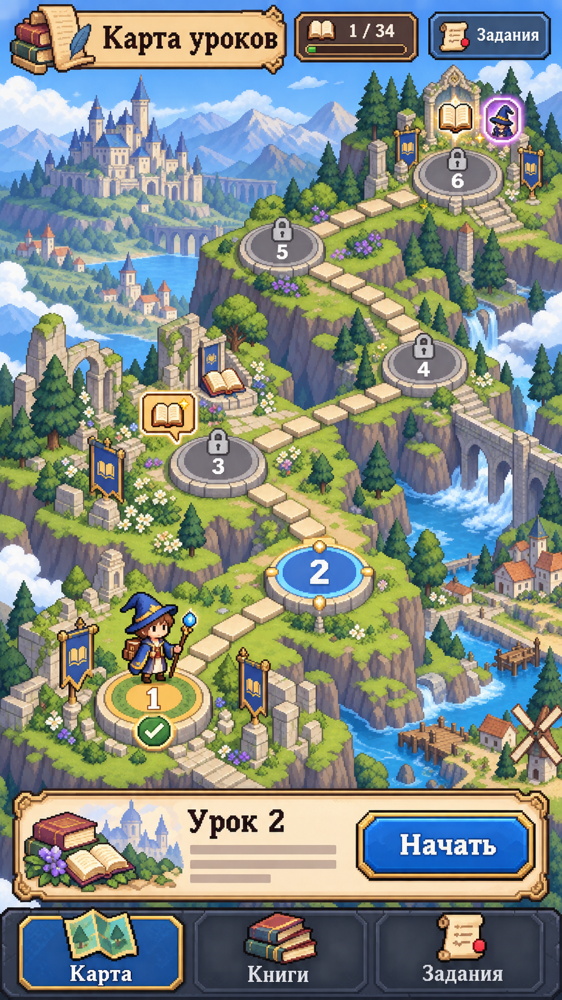
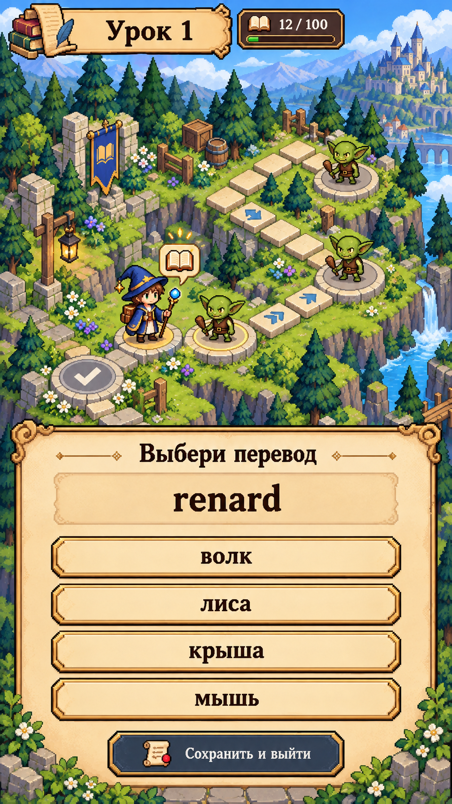
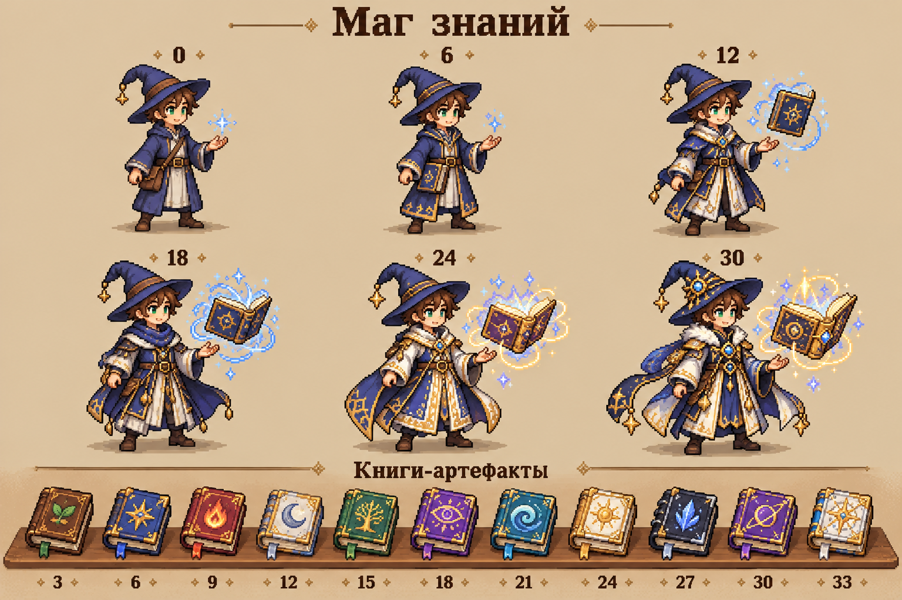
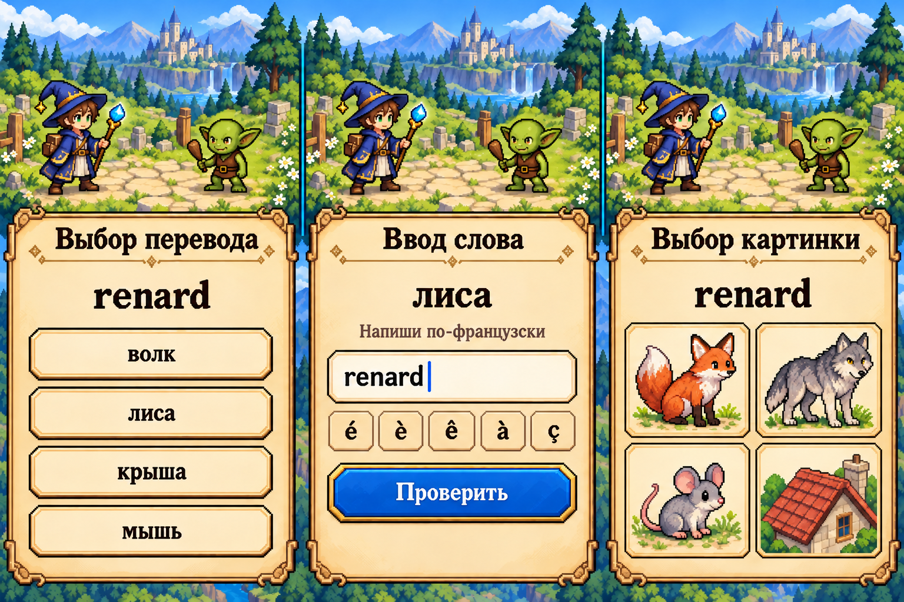

# Визуальные референсы игры

Четыре концепта для мобильной браузерной игры по французскому языку. Сгенерированы 15 октября 2026 года встроенным `image_gen`; исходные промпты и единственная корректирующая итерация сохранены в [PROMPTS.md](PROMPTS.md). Механики, архитектура и критерии реализации описаны в [PRD](../docs/PRD.md).

| Итоговый референс | Размер | Что фиксирует |
| --- | --- | --- |
| [01 — Карта уроков](01-world-map.png) | 941 × 1672 | Аксонометрическая карта, путь мага между уроками, завершённый/доступный/закрытый узел, будущие награды, вход в задания. |
| [02 — Внутри урока](02-lesson-encounter.png) | 941 × 1672 | Передвижение от гоблина к гоблину, одинаковый вид мобов, счётчик слов, вопрос поверх видимой сцены. |
| [03 — Маг и книги](03-mage-progression.png) | 1536 × 1024 | Шесть обликов мага и одиннадцать книг-артефактов, открываемых за прохождение уроков. |
| [04 — Три формата вопросов, итог](04-question-modes-v2.png) | 1536 × 1024 | Выбор перевода, ввод французского слова, выбор картинки; единый гоблин из референса 02. |

## Карта уроков

Показан фрагмент из шести узлов общей кампании в 34 урока. Урок 1 завершён, урок 2 доступен, следующие узлы закрыты. Значки у уроков 3 и 6 показывают будущие награды. Числа на узлах — номера уроков, а не количество слов. Карта прокручивается по мере продвижения; весь курс не требуется умещать на одном экране.

## Внутри урока

Один гоблин обозначает одно слово или выражение. Персонаж перемещается по пути к следующей встрече. Три видимых гоблина используют одинаковый образ: зелёная голова, большие уши, коричневая туника с поясом и маленькая деревянная дубинка. Правильный ответ запускает ненасильственный магический эффект победы.

Пример `renard → лиса` взят из каталога `data/lesson_vocab.tsv`, источник — `A1 01.pdf`, страница 3. `12 / 100` — иллюстративный прогресс внутри длинного первого урока; окончательное число встреч определяется проверенным игровым набором. Отдых или выход сохраняет позицию и не создаёт новый уровень.

## Развитие персонажа

Числа 0, 6, 12, 18, 24, 30 над персонажами означают количество впервые завершённых уроков. `0` — начальный облик до завершения первого урока, а не отдельный нулевой уровень. Новый артефакт выдаётся на отметках 3, 6, 9, 12, 15, 18, 21, 24, 27, 30, 33. На кратных шести отметках выдаются и книга, и новый облик.

Книги хранятся в коллекции. Количество книг, нарисованных на самом персонаже, не является счётчиком инвентаря: для читаемости на маленьком экране показывается только часть. Узнаваемая шляпа, лицо и общий силуэт сохраняются; развитие заметно по одежде, деталям и магии.

## Три формата вопросов

Во всех трёх вариантах используется одно учебное слово. Слева игрок выбирает `лиса` для `renard`; в центре вводит `renard` по русской подсказке; справа выбирает лису среди четырёх иллюстраций. До ответа правильный вариант не выделен. Ввод на телефоне использует системную клавиатуру; небольшая строка акцентов служит дополнительной помощью.

[Первая итерация экрана 04](04-question-modes.png) сохранена для истории. В итоговой версии гоблин приведён к дизайну из экрана 02. При реализации использовать `04-question-modes-v2.png`.

## Как использовать при реализации

- Общий художественный язык: чёткие пиксельные формы, аксонометрические дорожки, природное окружение, пергаментные панели, синий и золотистый акценты мага и интерфейса.
- Эти PNG — концепты композиции и стиля. Они не являются готовыми тайлсетами, спрайт-атласами, анимациями или адаптивными экранами. Производственные спрайты нужно подготовить на общей пиксельной сетке и проверить в реальном мобильном масштабе.
- Текст, вопросы, поля ввода и кнопки реализуются через HTML, а не вырезаются из изображений. Учебная типографика должна сохранять читаемость кириллицы и французских диакритических знаков.
- Образцы иллюстраций ответов показывают художественное направление. Для каждого слова отдельно проверяются смысловая однозначность, соответствие уроку и варианты ответа.
- Экран урока сохраняет приоритет вопроса и крупных кнопок. При открытой клавиатуре сцена может уменьшаться; компоновку из концепта нельзя переносить как фиксированную картинку.
- На десктопе показывается та же мобильная композиция в ограниченном по ширине контейнере. Отдельная десктопная сцена на этом этапе не нужна.

Визуальная проверка выполнена: на карте присутствуют шесть связанных узлов и состояния доступа, внутри урока — три одинаковых гоблина, на листе развития — шесть обликов и одиннадцать книг, на итоговом листе вопросов — ровно три требуемых формата. Все изображения открываются как PNG.
